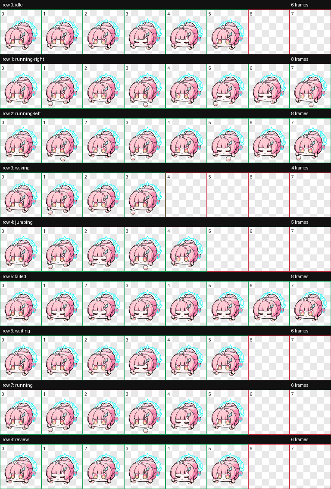

# Aemeath Cube Codex Pet

Wuwa Tappo의 **에이메스 새알심(Aemeath Cube)**을 Codex에서 사용할 수 있도록 정리한 비공식 커스텀 펫입니다.

Codex Dots를 활용해 Wuwa Tappo의 에셋을 언팩하고, 원본 눈 깜빡임과 손 동작을 Codex 펫 형식으로 구성했습니다.

## Design

<p align="center">
  
</p>

## Preview

<p align="center">
  
  
</p>

위 애니메이션은 원본 PNG 프레임의 부드러운 반투명 가장자리를 보존한 무손실 WebP 미리보기입니다. 실제 Codex에서의 재생 속도와 동작 전환은 앱 상태에 따라 달라질 수 있습니다.

원본의 눈·손 동작을 9개 상태에 배치했습니다. `running`이나 `jumping` 상태에서도 이 동작을 사용하며, 별도의 달리기·점프 포즈나 시선 추적 프레임은 포함하지 않습니다.

<details>
<summary>전체 애니메이션 프레임 보기</summary>



</details>

## Install

로컬 커스텀 펫을 지원하는 Codex Desktop이 필요합니다. 아래 명령은 macOS / Linux 셸용입니다.

```sh
git clone https://github.com/NARARIA03/aemeath-cube-codex-pet.git
cd aemeath-cube-codex-pet
./install.sh
```

기본 설치 위치는 `~/.codex/pets/aemeath-cube/`입니다. `CODEX_HOME`을 설정했다면 해당 경로의 `pets/aemeath-cube/`에 설치합니다. 같은 이름의 폴더가 이미 있으면 덮어쓰지 않고 종료합니다.

설치 후 Codex의 **Settings → Pets**에서 목록을 새로고침하고 **에이메스 새알심**을 선택하세요. 목록에 보이지 않으면 앱을 다시 실행해 주세요. 펫 표시 기능은 `/pet` 또는 **Show pet**으로 켤 수 있습니다. 메뉴는 앱 버전에 따라 다를 수 있으며, 일반적인 사용 방법은 [OpenAI 공식 Pets 안내](https://learn.chatgpt.com/docs/pets)를 참고하세요.

### 직접 설치하기

저장소에서 **Code → Download ZIP**으로 파일을 내려받아 압축을 풉니다. `pet` 폴더를 `aemeath-cube`으로 이름을 바꾼 뒤, Codex 설정 경로의 `pets` 폴더에 넣으세요. 기존에 같은 이름의 펫이 있다면 먼저 백업해 주세요.

```text
~/.codex/pets/aemeath-cube/
├── pet.json
└── spritesheet.png
```

`CODEX_HOME`을 사용하는 경우 `~/.codex` 대신 해당 경로를 사용합니다. 제거할 때는 설치한 `aemeath-cube` 폴더를 삭제하고 앱을 다시 실행하면 됩니다.

## Files

| 파일 | 용도 |
| --- | --- |
| `pet/pet.json` | 펫 이름과 스프라이트 경로를 담은 매니페스트 |
| `pet/spritesheet.png` | Codex용 투명 배경 스프라이트 시트 |
| `docs/design.png` | 캐릭터 디자인 미리보기 |
| `docs/aemeath-preview-1.webp`, `docs/aemeath-preview-2.webp` | 애니메이션 미리보기 |
| `docs/contact-sheet.png` | 상태별 전체 프레임 미리보기 |
| `install.sh` | 로컬 설치 스크립트 |
| `LICENSE.md` | 원작 및 에셋 권리 고지와 이용 안내 |

스프라이트는 기존 패키지의 **v1 형식**을 유지합니다: PNG RGBA, `1536 × 1872`, 8열 × 9행, 프레임당 `192 × 208`.

## Source & Rights

이 패키지는 [Wuwa Tappo](https://download-wutheringwaves-wuwatappo.kurogames-global.com/download/kr/)의 에이메스 에셋을 Codex Dots로 언팩하고, 원본 눈·손 동작을 Codex 펫 형식에 맞게 배치했습니다.

**[명조: 워더링 웨이브(Wuthering Waves)](https://wutheringwaves.kurogames.com/kr/), 에이메스 및 이 패키지에 사용된 원본 캐릭터 디자인·이미지 에셋의 저작권과 모든 지적 재산권은 [Kuro Games](https://www.kurogames.com/)에 귀속됩니다.**

개인 Codex 환경을 위한 비공식 팬 패키지입니다. 원작 에셋의 이용에는 원 권리자의 약관과 권리가 적용되며, 자세한 내용은 [LICENSE.md](LICENSE.md)를 참고해 주세요.

## Credits

- 원작사: [Kuro Games 공식 사이트](https://www.kurogames.com/)
- 원작 게임: [명조: 워더링 웨이브 공식 사이트](https://wutheringwaves.kurogames.com/kr/)
- 에셋 출처: [Wuwa Tappo 공식 사이트](https://download-wutheringwaves-wuwatappo.kurogames-global.com/download/kr/)
- README 구성과 권리 고지 참고: [hyeonbungi/aemeath-codex-pet](https://github.com/hyeonbungi/aemeath-codex-pet), [참고 LICENSE](https://github.com/hyeonbungi/aemeath-codex-pet/blob/main/LICENSE.md)
